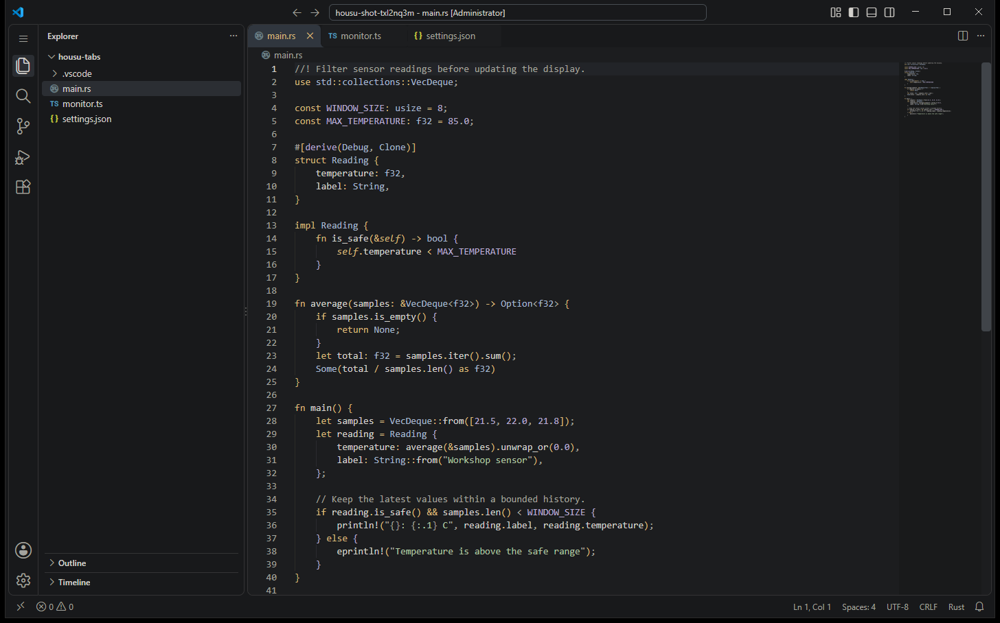

<div align="center">

</div>

# Housu 后素

A calm charcoal theme for VS Code, inspired by
[Gruber Darker](https://github.com/rexim/gruber-darker-theme).

The icon spells **后素** (*hòu sù*), a name drawn from **绘事后素** in
the *Analects* — often understood as “painting follows the plain ground.”
For Housu, it expresses a simple idea: start with a quiet foundation, then add
color where it helps. The soft amber lettering reflects that restraint.

Warm gray text, amber keywords, blue types, sage strings and lavender literals
keep code readable. Active tabs and selections have distinct backgrounds;
comments stay legible without competing with the code.



## Build and install

Requires Node.js 22 or later. Packaging downloads the pinned VS Code extension
packager on first use. The extension itself has no runtime dependencies.

```sh
npm run build          # validates and creates housu.vsix
npm run install:local  # installs it into VS Code
```

Open **Preferences: Color Theme** (`Ctrl+K Ctrl+T` on Windows/Linux,
`Cmd+K Cmd+T` on macOS) and choose **Housu**. After upgrading, run
**Developer: Reload Window**.

## Develop

Edit [themes/housu-color-theme.json](themes/housu-color-theme.json) directly.
There is no generation step. Modern tab colors also appear as theme-scoped
configuration defaults in [package.json](package.json); keep them in sync.

```sh
npm run validate
```

The dependency-free Node validator checks release metadata,
color values, required highlight transparency, tab consistency and 2,616 text
contrast pairs. All checked text meets WCAG AA (4.5:1); the current minimum is
4.87:1. Alpha backgrounds are composited before measurement. VS Code's theme
JSON schema supplies color-ID validation while editing.

Font family, size and spacing follow your editor preferences. Display brightness
and room lighting also affect reading comfort.

## Release

Update the version in `package.json`, run `npm run build`, and review `housu.vsix`.
Upload that file to the VS Code Marketplace publisher dashboard or attach it to
a GitHub release. Generated packages are ignored by Git. `.vscodeignore` limits
the extension package to its release files.

## License

MIT. See [LICENSE.md](LICENSE.md), including the Gruber Darker attribution.
